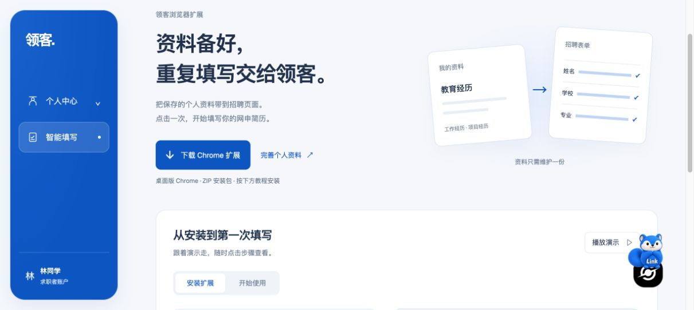

# 正式站发布与验收结果

日期：2026-10-18。入口：`https://linkaigo.com`。用户已明确授权备份后切换正式站，并删除指定历史镜像。

## 发布结果

| 项目 | 结果 |
| --- | --- |
| 正式 API | `lingke-autofill-test:launch-fix-20261018-r2`，镜像 `b2d65eb28838`；使用正式环境配置和正式数据库，不使用测试库 |
| 正式 Web | `lingke-web:launch-ready-20261018`，远端镜像 `abf84850ff8c` |
| 正式扩展 | `0.3.2`，构建 `68cf21b0abf170ca6954`，ID `jmfbkpdfefifliffkdkmljihmkeapjkb` |
| API / 登录凭证 | `https://linkaigo.com/api`，主站 `lingke_session` Cookie |
| 数据与迁移 | 正式库已备份；8 个迁移与候选源码一致，无新增迁移；保留既有邮箱加密密钥 |
| 回滚 | 原 API/Web 已保留精确镜像标签，配置与数据库备份位于服务器私有目录 |
| 基础服务 | PostgreSQL、Redis、Caddy 容器均未重启；Caddy 原有测试路径保留，正式上游改为唯一别名后校验并热加载 |
| 磁盘 | 指定旧镜像及其三条非共享缓存已回收，余约 1.3GB；没有执行全局 prune 或删除数据卷 |

正式 Web 复用测试候选的相同依赖层，传输约 1.39MB 的构建差异。远端 `/app` 下 1771 项文件、目录、链接及权限逐项与本机已冒烟的正式构建一致，运行配置也一致；因此镜像层摘要不同，但没有改变已验证的应用内容。

下载包 SHA-256：`0abd3e07f66b1278a0b233edbd3bb590bd0faedc7b941b18d2f9d18e8bebe60f`。浏览器从正式智能填写页面实际下载的 ZIP 与接口校验的 ZIP 完全一致；更新既有扩展时权限和固定 ID 不变，用户已手动重载。

## 本轮发现并修复的部署问题

**BUG-11：正式站与测试站的代理 DNS 别名冲突，已修复（`80c7d3c`）。**

两套 Compose 的 API/Web 服务在共享代理网络上都自动注册 `api`、`web`。原主站 Caddy 使用这些名称，可能随机转到带测试路径的 Web 或测试 API；健康接口正常不能证明路由正确。正式切换的前两次公开下载校验失败，已自动回滚，未把失败当上线成功。

修复为正式服务增加 `lingke-production-api`、`lingke-production-web`，Caddy 明确使用这两个唯一上游。测试路径继续使用 `autofill-test-api`、`autofill-test-web`。仅替换原主站文件中的两处上游，其余现有配置保留，并执行 Caddy validate/reload。此修复不涉及页面扫描、经历增减、匹配或填写逻辑。

## 正式站验收

| 功能 | 结果与范围 |
| --- | --- |
| 首页、登录、注册、找回页面 | HTTP 200；页面可访问不等于本轮重新完成 CAPTCHA/真实邮件流程 |
| 网页登录与工作台 | 真实 Chrome 普通合成账号登录，进入 `/workspace/autofill` |
| 下载与教程入口 | 真实页面可见、浏览器下载完成，ZIP 校验通过 |
| 扩展后端接缝 | 普通角色无 debug 权限；Cookie 登录、readiness、固定扩展来源 CORS 通过，非允许来源 403、未登录资料 401 |
| 简历读取与保存 | 新建受控普通 QA 账号，18 条合成经历读取通过；只保存基本资料后，经历值、ID 和版本不变 |
| 隔离站回归 | `/autofill-test` 网页与 API 健康正常，原有测试数据不迁入正式库 |
| 美团真实填写 | 首轮 16 条适用经历数量正确、独立 DOM 核对 85/86；正式按钮重试后补齐性别，扩展已验证 86、待处理 13、提醒 2，性别另经原生页面 UI 独立确认 |

美团首轮在 46.275 秒仍运行、65.231 秒观察到终态；不能将 65.231 秒冒称精确引擎耗时，也不能据此确认本轮是否低于 60 秒。报告为“已验证 85、待处理 14、页面提醒 2”。其中 13 个待处理项为缺少等价资料或不适用来源；另外 1 个性别字段属于实际待补填问题。没有点击网站保存、提交或投递。

**BUG-12：美团性别选项偶发等待超时，稳定性问题保留。** 第一轮最终显示旧值，不能计入正确覆盖；扩展没有误报成功。再次勾选覆盖并真实点击“重新扫描填写”后，报告已验证 86 项；回到基本信息，原生页面 UI 独立显示“女”，与源简历一致。最终核对依据为首轮 85 项独立 DOM 核对，加上重试后性别的独立 UI 核对，不声称重试后又完整 DOM 回读 86 项。重试期间浏览器连接恢复影响计时，未报告其精确耗时。没有修改填写代码，也不把一次重试成功视为已根治超时。

QA 账号由内部夹具创建，仅包含合成资料，使用正常密码散列、普通权限与公开登录接口；没有修改其他用户资料或公开认证逻辑。它不代表本轮重新验收了生产注册/验证码流程。真实邮箱连接、收信同步、并发和长期稳定性仍未完成验收。

## 运维入口与证据

- 固定发布配置：`/opt/lingke/releases/launch-20261018/`，包含两份 Compose、镜像标签、源码 `80c7d3c` 与运行镜像凭证；后续不依赖可变的测试目录来定位发布配置。
- 私有备份：`/opt/lingke/backups/launch-20261018/`，目录权限 700、文件权限 600。`pg_restore --list` 校验通过；数据库备份 SHA-256 为 `3f891a260e7e1e9b52ee26296ee0853bff58dee0b6b681285fb79c5049422d3e`。
- 原 API：`lingke-api:before-launch-20261018`（`32a6e593e2c2`）；原 Web：`lingke-web:before-launch-20261018`（`aab20a9e7e48`）。
- 复测与发布证据仅保存在忽略目录 `apps/extension/.test-dist/launch-fix-20261018/`，不提交凭据、Cookie 或简历内容。自动化 156 项及 PostgreSQL 集成结果见[修复准备报告](../testing/launch-readiness-2026-10-18.md)。
- 后续操作使用[发布与回滚清单](production-promotion-2026-10-18.md)；回滚应用时保留已修复的唯一代理别名，避免重新引入主站/测试站路由冲突。
