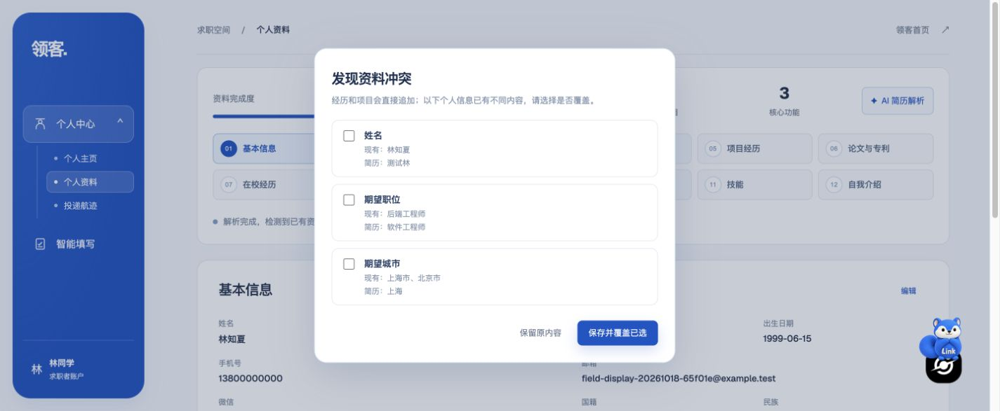

# 远端 AI 服务修复

2026-10-18；隔离测试站 `https://linkaigo.com/autofill-test`，配置修复提交 `d390f10`，对应原报告 BUG-03。

## 原因与修复

1. 共用 Caddy 的测试 API 白名单缺少五个 AI 路径。修复前五个接口均为 404，未进入后端。现已逐项放行 `/ai/resume/parse`、`/ai/resume/parse-file`、`/ai/resume/normalize`、`/ai/autofill/suggestions`、`/ai/vision/extract`，其他未列路径仍为 404。
2. 测试 API 容器只有 `AI_PROVIDER_MODE=http`，没有供应商地址、模型名、密钥及 OCR 配置。Compose 现加载测试专用 `.env.autofill-ai`，经用户明确授权复用已有供应商配置；文件权限 600、不入库，未带入主站数据库、会话或业务配置。

不是 `deepseek-v4.1-flash` 模型名称失效。现有两路文本供应商的最小真实请求均返回 200 和有效 JSON；正式任务也已验证。测试数据库与 Cookie 隔离检查通过。没有修改 AI 提示词、重试策略、简历保存或页面填写引擎。

## 复测

| 范围 | 结果 | 本次单轮耗时 |
| --- | --- | ---: |
| 五个 AI 路由未登录请求 | 全部 401，鉴权仍有效 | 各约 0.5 秒 |
| 四种空输入 | parse、parse-file、suggestions、vision 均 400 | 各约 0.5 秒 |
| TXT：提取 → 标准化 → 数据库预览 | 200；九类分区共 10 条合成记录，有效姓名与数据库行预览 | 21.535 秒 |
| DOCX：解包正文 → 提取 → 标准化 → 预览 | 200；有效姓名与教育行预览 | 37.906 秒 |
| PDF：渲染 → 百度 OCR → 标准化 → 预览 | 200；1 页，OCR 和文本模型均成功 | 34.357 秒 |
| 图片视觉识别 | 200；正确识别 Alex Example、TypeScript、SQL | 2.913 秒 |
| 填写建议 | 200；返回合成资料中的姓名 | 3.482 秒 |
| 未注册页面的 AI 字段匹配 → 计划 | resolvedBy=ai；计划值来自当前数据库资料 | 4.388 + 0.506 秒 |
| 真实 Chrome 上传 TXT | 系统文件选择器上传，页面显示已解析姓名及职位/城市冲突预览 | 未作精确计时 |
| 预览无写入 | 未确认导入；最终 18 条经历、ID、资料与版本摘要和原基线一致 | 通过 |

耗时为本次请求到响应的墙钟时间，不代表性能分位数或复杂简历全字段准确率。文本任务使用配置模型 `deepseek-v4.1-flash`；视觉使用现有配置 `deepseek-flash`，实际图片识别通过。PDF 使用现有百度 OCR。此次未把真实用户简历发给模型，也未导入、覆盖用户资料。

AI 网关/生命周期/OCR 24 项、填写后端 8 项，共 **32 项相关模块测试通过**。Compose 实际渲染后核对供应商配置、测试库和 Cookie；Caddy 候选配置 validate 后再热加载。只重建测试 API，复用原镜像；没有应用源码或依赖变动，未重复全量构建。

主站首页、主站与测试健康接口均 200。测试 `/admin`、`/ai/unlisted` 仍 404。主站 API/Web 启动时间未变。

## 运维记录

- 当前测试 API 镜像 `lingke-autofill-test:profile-field-display-20261018`，是之前 `profile-save-fix-20261018` API 镜像的同内容标签；此次通过重建容器加载新增环境配置。
- 代理备份 `/opt/lingke/deploy/Caddyfile.before-ai-recovery`；密钥仅保存在测试 checkout 的 `.env.autofill-ai`。回滚代理时先校验备份再热加载；回滚配置可恢复上一提交 Compose 并仅重建测试 API。保留受控密钥文件，不删除测试数据库卷。
- 本机原始接口结果、合成测试文件、模块日志与浏览器证据位于忽略目录 `apps/extension/.test-dist/ai-service-fix-20261018/`。仓库不包含任何密钥或测试账号密码。
- 本轮解决 AI 路由及供应商配置阻断；注册验证、日历时区、Moka 启用及完整招聘页面填写等其他缺陷不在修复范围内。
