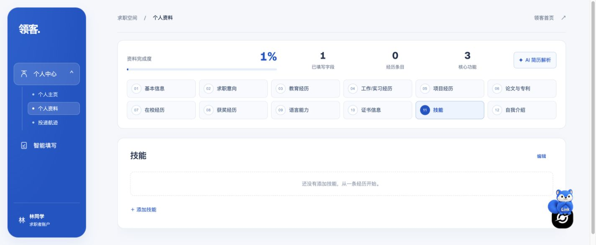

# 注册、验证码与密码找回修复复测

2026-10-18；对应测试计划 AUTH-01/02/03/04/05/06、BUG-02。配置修复提交 `46b247a`；隔离测试站 <https://linkaigo.com/autofill-test>。

## 修复内容

- Caddy 测试 API 白名单增加 register、email-code、forgot-password、reset-password、verify-email、resend-verification 六个现有账号接口。修复前均为 404。
- API 从测试专用 `.env.autofill-auth` 加载发信与阿里云验证码配置；用户已明确授权复用现有供应商设置。文件权限 600、不入库，不复制主站数据库、会话或收信凭据。
- 移除测试 Web 构建中写死的 CAPTCHA disabled，改用四个必填公开构建参数，并重新构建网页镜像。服务端人机验证保持开启，没有使用生产环境跳过验证的开关。
- 保留独立的测试 `EMAIL_CODE_SECRET`、`APP_URL`、数据库和 Cookie；邮件链接指向 `/autofill-test/reset-password` 或 `/autofill-test/verify-email`。

本轮没有改变密码、验证码、角色、资料保存或填写引擎的业务逻辑。新增认证集成测试以验证现有逻辑在部署配置修复后可用。

## 按测试计划复测

| 计划项 | 已验证内容 | 结果 |
| --- | --- | --- |
| AUTH-01 注册输入 | 短密码、确认密码不一致、缺邮箱码、错误邮箱码拒绝；注册默认为普通用户，不能提交 admin 提权 | 本地集成及远端接口通过 |
| AUTH-01 邮箱验证码 | 本地实际 SMTP 对话收取六位码；60 秒冷却；错误码拒绝；有效码注册为已验证邮箱 | 本地及真实收信注册通过；用户完成 CAPTCHA、收取 QQ 邮箱码并注册，后端确认验证码已消费且 attempts=0，普通账号已验证 |
| AUTH-02 登录 | 正确密码登录、错密码拒绝、独立 Cookie 名称及路径 | 本地集成通过；真实注册自动登录、重置后新密码登录及 Chrome 刷新工作台通过 |
| AUTH-03/04 会话 | 重置后旧会话失效，退出后当前会话失效 | 本地集成通过；实网重置后原 1 条会话已撤销，新登录产生 1 条有效会话；退出场景限本地集成 |
| AUTH-05 权限与资料 | 注册 role 保持 user；密码重置不改变资料、版本或经历 ID；原 18 条远端合成记录不变 | 通过 |
| AUTH-06 找回密码 | 未知邮箱与已知邮箱响应消息一致；本地 SMTP 收取带正确测试前缀的重置链接 | 本地及实网通过；用户确认收到 QQ 找回邮件，并通过测试链接完成重置 |
| AUTH-06 重置密码 | 无效、过期、重复令牌及短密码拒绝；新密码可登录，旧密码和旧会话拒绝 | 本地集成通过；用户完成真实网页改密、新密码登录，后端确认重置记录已消费、旧会话撤销，Chrome 刷新工作台通过；真实账号旧密码未采集、不由代理尝试 |
| AUTH-06 邮箱验证 | 本地 SMTP 收取验证链接；过期、无效、已使用令牌拒绝，有效令牌可验证 | 本地集成通过 |
| AUTH-06 网页反馈 | Chrome 在未注册合成邮箱的找回页提交后显示统一成功提示，没有 404/请求失败 | 通过；该请求不发送实际邮件 |
| 生产 CAPTCHA | 真实后端拒绝缺失/伪造参数，未出现服务未配置错误；未关闭人机验证 | 负向请求和用户完成的真实注册正向链路均通过 |
| 生产响应 | 13 项远端校验均不返回 debugCode/resetToken | 已测负向 HTTP 响应通过；真实流程不采集密码、验证码或令牌明文 |

自动化：API 66/66、Web 30/30；新增隔离 PostgreSQL + 本机 SMTP 捕获服务完成 8 组检查、5 封本地邮件。新增脚本 `apps/api/tests/auth-integration.mjs` 仅接受本机且名称以 `_auth_test` 结尾的显式数据库。运行：先给该空库应用现有迁移，再使用 `DATABASE_URL=... node apps/api/tests/auth-integration.mjs`；不调用外部发信服务。本机开发模式的 CAPTCHA 不能替代生产挑战验收。

远端现有 SMTP 供应商 `verify()` 鉴权检查通过；用户已完成真实 QQ 收信注册，浏览器实际进入工作台，后端确认普通用户、emailVerified=true、验证码已消费且 attempts=0。随后代理通过网页发起找回密码，用户确认收到邮件、自行完成网页改密及新密码登录。最终后端核对：新重置记录 1 条且已消费、旧 Web 会话 1 条全部撤销、新有效 Web 会话 1 条、资料版本与记录数保持原样。Chrome 实际刷新后仍能访问资料页。真实注册 → 邮件找回 → 网页重置 → 新密码登录闭环通过。

密码设置/重置与 CAPTCHA 均由用户亲自完成。复测仅读取账号状态、重置记录及会话元数据，不读取或保存密码哈希、令牌值、Cookie 或派生认证材料。旧密码拒绝、过期/复用令牌等边界由本地集成覆盖，不冒称在真实账号上重新执行。

## 部署与回滚

Web 镜像 `lingke-autofill-web:auth-recovery-20261018`（linux/amd64），manifest index SHA-256 `a3d9b01c60462047132db8e559d9d6ab449a706d07eeb6d3bc070f4fe92b276a`，包含公开 CAPTCHA 参数。API 镜像 `lingke-autofill-test:auth-recovery-20261018` 为此前 API 镜像的同内容标签，通过重建容器加载新增配置；没有迁移数据库。

Compose 渲染检查确认认证设置、公开 CAPTCHA 构建值一致，原 AI/OCR 设置未变。Caddy 候选配置 validate 后热加载。主站 API/Web 启动时间未变，主站首页与主站/测试健康接口为 200，未开放的测试 `/admin` 保持 404。

回滚备份：测试 `.env.autofill-test.before-auth-recovery`、主站代理 `deploy/Caddyfile.before-auth-recovery`。回滚先校验代理备份再热加载，恢复上一测试 release；保留数据库卷和受控凭据文件。

原始测试结果、本机日志和人工操作截图在忽略目录 `apps/extension/.test-dist/auth-service-fix-20261018/`；真实重置结果见 `real-reset-complete-results.json`。不入库用户指定的真实邮箱、密码、验证码或令牌。仓库截图使用不显示邮箱的只读资料分区。本次补测只更新文档与证据，没有再次修改源码或部署镜像。
