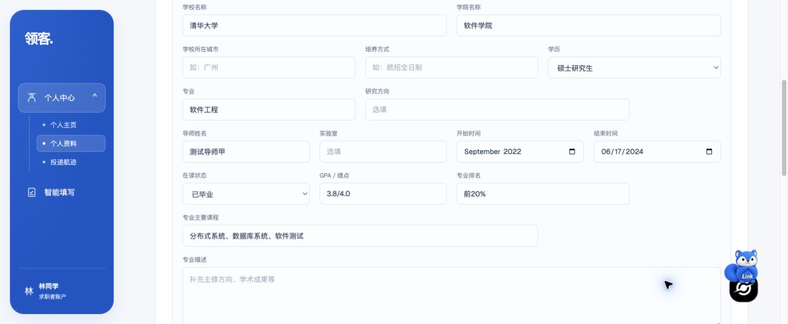

# 经历编辑回显修复与复测

2026-10-18；对应原测试报告 BUG-04、PRO-03。功能提交 `026e301`，已推送 `codex/autofill-remote-test` 并部署隔离测试站 <https://linkaigo.com/autofill-test/workspace/profile>。

## 修复范围

- 月份日期按月显示，完整日期保留日精度；`2018/9`、`2025年1月` 等仅转换控件显示，不改写原始草稿或数据库值，也不补日期中的日。
- 只有年份、`至今`、无法识别或不合法的日期原样显示为文本，避免浏览器显示空白。清空完整日期后，在同次编辑中仍使用完整日期控件。
- 学历“硕士研究生”“大学本科”和语言“日常会话”等已有值加入当前下拉选项，保持原值选中。没有值时显示占位项，不默认选第一项。
- 新增经历的空日期默认月份；出生日期等基本资料仍按日输入。

改动仅在 Web 通用字段显示层。沿用之前的局部分区保存与稳定记录 ID，不修改 API、数据库结构或招聘网页填写引擎。

## 验证结果

| 检查 | 结果 |
| --- | --- |
| Web 模块测试 | 30/30 通过，含新增 8 项日期/选项/保存回归 |
| Web 类型检查 | `tsc --noEmit` 通过 |
| Web 生产构建 | linux/amd64 Docker 构建通过 |
| 教育编辑实际回显 | 两条原有学历选中；`2022-09`/`2018/9` 显示月份，`2024-06-17` 保留日 |
| 不修改直接保存 | 全部 18 条经历、ID、原始日期/学历、其他资料和 profileVersion 不变 |
| 只修改专业 | 仅目标专业变化，日期/学历及其余资料保留 |
| 实际键盘修改并刷新 | 开始时间改为 `2022-10`，结束时间改为 `2024-06-18`，学历改为“本科”；只有这三项变化，18 条 ID 不变 |
| 清空完整日期再输入 | 原生键盘清空后仍为 date 控件，可重新输入日；本项取消退出 |
| 项目中文月份 | `2025年1月` 显示 `2025-01`；不修改保存后数据库原值保留 |
| 在校经历年份 | `2020` 原样显示为文本，没有补月份 |
| 证书及基本日期 | 证书 `2024-06-17`、生日 `1999-06-15` 保留日精度 |
| 下拉自定义值 | “日常会话”正确选中，不修改保存后原值保留 |
| 新增经历 | 空日期默认 month 控件；取消后不产生记录 |
| 最终全量数据比对 | 恢复三个已修改测试字段后，18 条记录/ID、全部资料、嵌套 extra、主页头像和版本摘要与基线一致 |
| 服务健康 | 测试及主站健康接口、测试登录页均 200 |

真实 Chrome 使用独立合成账号和现有 18 条经历。日期修改用原生日期分段和键盘完成；最初自动化 fill 只改变日期控件 DOM、未触发有效保存，未将该次尝试算作通过，随后使用真实按键保存并通过接口及刷新复核。恢复测试值使用原 ID 的定向资料接口，不影响用户账号。

## 部署与证据

Web 镜像 `lingke-autofill-web:profile-field-display-20261018`，manifest index SHA-256 `8fc1c39b6bf2e8701736e8ab7d56aa1c9a79ed7e3c8420ca8a51817a473f78eb`。只重建测试 Web 容器，API 继续运行之前的 `profile-save-fix-20261018` 镜像；新发布 API 标签只是同一镜像的别名。主站服务未重启，无数据库迁移。

配置备份 `.env.autofill-test.before-field-display`；需要回滚时恢复上一 release 并仅重建测试 Web。未清理主站镜像或数据库卷。

原始 HTTP 基线、浏览器控件读值、测试与构建日志保存在忽略目录 `apps/extension/.test-dist/field-display-fix-20261018/`，凭据不入库。截图仅含合成资料。本轮不代表原报告中其他部署、AI、日历或招聘网页填写问题已修复。
