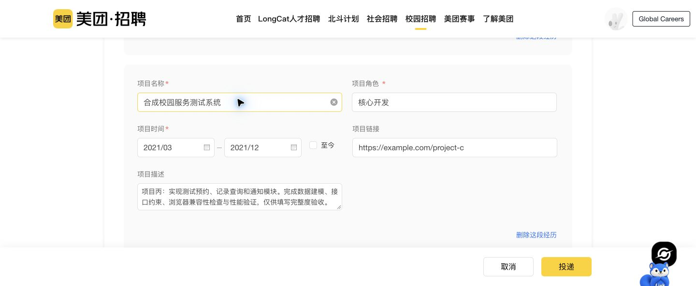

# 领客产品功能测试结果

日期：2026-10-18；需求：[PRD](../product/prd-v0.3.md)；计划：[测试计划](product-test-plan-2026-10-18.md)。

## 环境与方法

- 产品基线 `b26bae5`（最新功能 `da6fea2`）；GitHub 分支 `codex/autofill-remote-test` 与远端隔离 checkout 一致。
- 实测环境为 `https://linkaigo.com/autofill-test`，Web/API 镜像标签 `profile-avatar-20261018`；不是生产主站的全量验收。
- 使用既有 18 条经历的合成账号跑接口/填写；另克隆专用普通用户账号做真实保存测试，避免影响既有基线。
- 本轮不修改产品源码、站点规则或环境配置。测试脚本、PRD 和报告属于本轮新增产物。
- 状态：“通过”限列出的范围；“Bug”有失败证据；“阻塞/未测”没有完成实网闭环，不能算通过。单元/契约测试不等于端到端通过。

## 自动化结果

| 层级 | 本轮结果 | 说明 |
| --- | --- | --- |
| 契约/API/扩展/Web 现有测试 | 99/99 通过 | 5 + 66 + 10 + 18；Worker/shared 语法检查另计 |
| 本地隔离 PostgreSQL 集成 | 通过 | Cookie 自定义名称/路径、角色隔离、两账号、导出、规则/计划、资料增删恢复、失效会话等；AI 为 fake，不代表真实模型可用 |
| 远端业务 HTTP 主测试 | 57 项；复核后 47 通过、10 失败 | 原始记录 45/12；预期 302 重定向、普通用户访问未开放旧规则接口的 404 被初版脚本过严误报，分别复核为通过，原日志保留 |
| 远端补充 HTTP | 7/7 断言通过 | 含跨账号拒绝、美团精确计划、未知页/Moka 失败信号、空导入幂等；未知页断言通过仅说明正确返回未解决，不是 AI 匹配通过 |
| 远端导入冲突补测 | 4/4 通过 | 实际数据库验证冲突检测、keep、replace、重复幂等；结束恢复原姓名与版本 |
| Web 类型检查 | 通过 | `tsc --noEmit` |
| 全工作区生产构建 | 通过 | `pnpm build`，包含扩展、API、Next 页面构建 |
| 全工作区 lint | 失败 | `apps/web` 使用 `next lint`，当前 Next 将 lint 当成目录；见 BUG-08 |

主测试的十个失败断言：六个账号业务路径 404、三个 AI 简历路径 404、一个无效任务状态未拒绝。它们按根因合并为下方缺陷，不按十个独立 Bug 夸大。

## 功能结果总表

| 计划编号 | 功能 | 结论 | 实际范围/问题 |
| --- | --- | --- | --- |
| ENV-01 | 已有改动上传、隔离服务健康 | 通过 | 测试提交一致，主站及测试健康接口 200，数据库 healthy |
| WEB-01 | 测试入口与工作台导航 | 通过 | 测试根路径按设计 302 到智能填写；主页、资料、航迹和教程均真实打开 |
| AUTH-01 | 注册与验证码 | Bug / 部署阻塞 | 重复密码校验正常；点击验证码提示人机验证未配置；注册/验证码 API 404 |
| AUTH-02 | 现有账号网页登录 | 通过 | 实际 Chrome 两个普通合成账号登录，错误密码拒绝，安全 Cookie |
| AUTH-03/04 | 未登录保护、退出与回跳 | 通过 | 资料、任务、投递、邮件、readiness 未登录 401，退出后旧 Cookie 失效；Chrome 站外 next 回跳补测见证据 |
| AUTH-05 | 普通用户权限、数据隔离 | 通过（接口/集成） | 禁止自助提权；远端跨账号投递/任务/教育记录均 404；普通扩展无 debug/密码表单 |
| AUTH-06 | 邮箱验证、找回/重置密码 | Bug / 部署阻塞 | 对应 API 404；浏览器找回页提交显示“请求失败”；没有执行实际密码变更 |
| PRO-01 | 基本资料编辑与保存 | Bug | 字段保存本身成功，但只修改微信会删除未被 UI 识别的技能，并重建经历 ID |
| PRO-02 | 经历新增/更新/软删/恢复 | 通过（资源 API）；草稿 UI 通过 | 教育/工作/项目/技能四资源 CRUD + 恢复；UI 新增教育、移除、撤销、取消通过；持久化仍受 PRO-01 缺陷影响 |
| PRO-03 | 九类经历与编辑回显 | Bug | 技能分区漏 TypeScript；教育已有月份日期和学历别名在编辑控件中显示为空/请选择 |
| PRO-04 | 结构化导出与版本 | 通过 | 九类 18 条记录、稳定 SHA-256、下载头、内部字段清理；改资料改变版本，恢复后一致 |
| IMP-01/02 | TXT/MD/PDF/DOCX AI 解析 | Bug / 部署阻塞 | 三个 AI 路径 404；格式/映射相关模块测试通过不代表远端上传可用；真实文档识别未完成 |
| IMP-03 | 结构化导入、冲突、幂等 | API 通过；文件闭环阻塞 | 实际远端验证409冲突、keep、replace、重复幂等并恢复原资料；完整文件→预览→导入被解析入口阻断 |
| HOME-01 | 主页四字段、保存刷新、取消 | 通过 | 实际编辑姓名/城市/签名/描述；取消不保存，保存后刷新保留 |
| HOME-02 | 头像上传/预览/保存/移除 | 通过 | 真实系统文件选择器上传公开 PNG；保存刷新，移除保存、移除取消均验证；限制由模块测试覆盖 |
| HOME-03 | 主页与简历隔离 | 通过 | 18 条经历与 ID 不变、profileVersion 不变；导出不含主页/图片 |
| APP-01/02 | 投递创建、职位选填、查询、详情 | 通过（已测范围） | 真实只填公司创建，补填职位；API 清空职位、搜索、过滤、分页通过；UI 未提供搜索/筛选入口 |
| APP-03 | 状态、版本、幂等、填写事件 | 通过 | 非法投递状态拒绝、过期版本 409、重复创建去重；fill.completed 不冒充提交 |
| APP-04/06 | 面试时间、日历、详情弹窗 | 部分通过 / 时区问题 | 无结束时间可保存，详情分区/任务/底栏可操作；录入与日历采用不同的时区，见 BUG-07 |
| APP-05 | 跟进任务 | Bug（校验）；主操作通过 | Chrome 新增/勾选完成通过，API 完成/重开及幂等通过；API 接受任意无效 status |
| MAIL-01 | 邮件入口、空状态和供应商 | 通过 | 三接口 200，Chrome 邮箱管理/供应商切换/无账号禁同步正常 |
| MAIL-02 | 真实邮箱连接、同步、邮件识别 | 阻塞/未测 | 无合成收信邮箱和配置，未连接用户私人邮箱；邮件模块测试不代替实网闭环 |
| EXT-01 | 下载包和安装/使用教程 | 通过 | 远端 ZIP 200、可解压，脚本/manifest/build 完整；教程切换、下一步、播放按钮正常 |
| EXT-02 | 下载版扩展 Cookie 与普通 UI | 通过 | 实际 ID `jmfbkpdfefifliffkdkmljihmkeapjkb` v0.3.0，网页登录可识别；无账户密码及诊断表单 |
| EXT-03 | 填写服务协议、CORS、取消/超时 | 通过（API/模块） | readiness、来源白名单、账号绑定、协议、过期 deadline 拒绝；取消由已有模块测试覆盖 |
| EXT-04 | 美团真实填写、速度和完整度 | Bug | 两轮均已验证54、待处理28、页面提醒5；第二轮观测终态78.350秒，确定超过60秒预算；不是完整填写成功 |
| EXT-05 | Moka 规则真实填写 | 未通过（配置阻断） | 实际作业帮页面已验证0、待处理27、提醒2；部署 Moka 规则默认 off，模拟快照走未知站点且 provider-failed |
| EXT-06 | 未知网站真实 AI 兜底 | 阻塞 | 当前测试 API 没有模型名称/密钥配置，analyze 返回未解决绑定和 provider-failed；没有假装匹配成功 |
| QA-01/02 | 自动化、生产构建、lint | 部分通过 | 99 项 + PG 集成 + 构建/类型通过；lint 脚本失败 |
| QA-03 | 源码冻结与文档上传 | 源码冻结通过 | 201个产品相关文件测试前后哈希一致；本轮新增文档/测试脚本同步该分支与远端测试目录，发布记录以提交和远端核验为准 |

## 缺陷清单与复现

| 编号 | 优先级 | 范围 | 复现与实际结果 | 影响/定位 |
| --- | --- | --- | --- | --- |
| BUG-01 | P1 | 简历数据保存 | 专用账号接口有 18 条经历（含无 kind 的标准 TypeScript 技能）→资料页技能为空、统计 17→仅编辑微信并保存→接口剩 17 条、技能被软删除，其他经历 ID 全部变化 | `hydrateProfile()` 只保留 kind=skill，而保存基本资料提交所有经历并全量替换。不是主页头像导致 |
| BUG-02 | P1 | 测试部署账号链路 | 注册页点发送验证码→“人机验证服务尚未配置”；`/auth/register`、`/auth/email-code`、四条找回/验证路径 HTTP 404；找回页显示“请求失败” | 测试 Caddy 白名单未开放这些业务路径，且验证码供应商禁用；新用户不能完成入门 |
| BUG-03 | P1 | 测试部署简历解析 | 登录后 POST `/ai/resume/parse-file`、`/parse`、`/normalize` 均 404 | 源码接口存在，测试代理未放行；依赖的真实模型/OCR也没有完成配置验收 |
| BUG-04 | P2 | 经历编辑显示 | 已存教育月份日期如 2022-09、学历“硕士研究生/大学本科”→进入教育编辑→日期输入为空，学历显示“请选择学历” | 月份值与 date 输入格式不一致，学历别名未覆盖；本轮未保存该教育编辑，未宣称日期已丢失 |
| BUG-05 | P2 | 经历记录身份 | 只保存基本信息后原 17 条保留下来的经历内容重新创建，ID 均变化 | 无需变动经历时也全量软删重建，导致填写版本和记录引用不稳定；与 BUG-01 同一保存路径 |
| BUG-06 | P2 | 任务输入校验 | PATCH 专用任务 `{status:"not-a-real-state"}`→200，数据接受；测试随后恢复 open | 任务 update 未验证允许状态，可能产生 UI 无法正确解释的数据 |
| BUG-07 | P2 | 日历时间表达 | 浏览器编辑器输入 2026-10-21 14:30，日历显示北京时间 05:30（跨天） | 编辑器按浏览器时区、日历固定 UTC+8；日历有时区标识，编辑器没有。未证明存储时间丢失，问题是同一工作流时区表达不一致 |
| BUG-08 | P2 | 开发验收工具 | `pnpm lint`→Next 报找不到 `apps/web/lint` 目录，退出 1 | 当前 Next 不支持旧 next lint 命令；本轮保持未修复 |
| BUG-09 | P1 | 美团填写完整度 | 两次真实覆盖填写均为已验证54、待处理28、另有5区块提醒；包括语言考试超时，校园/荣誉/证书/论文/竞赛尚需手动打开 | 全简历不能一键完成；部分字段无资料属于合理跳过，不能把全部28项都归为错误填写 |
| BUG-10 | P2 | 美团填写速度 | 第二轮从真实按钮点击到观测终态78.350秒，73.050秒仍未完成 | 明确超过本轮60秒预算；包括扫描、探测、匹配、经历增减、回填与现有核验，不是单次API耗时 |

另有配置阻塞：Moka 规则默认关闭、未知站点 AI 未配置、真实邮箱未提供；不把它们写成已证明的解析算法 Bug。

## 招聘页面真实填写

### 美团

URL：`https://zhaopin.meituan.com/web/delivery-confirm?jobUnionId=4734968293&jobShareType=1&highlightType=campus`。

两轮均为网站下载的同一扩展、普通用户、原有完整18条合成经历；开启本次覆盖和更换学校时清空旧学院，由原生扩展按钮启动，立刻关闭弹窗，未调用内部 runner。每轮从独立刷新后的页面开始，没有点击网站保存或投递。

| 轮次 | 计时证据 | 报告结果 |
| --- | --- | --- |
| 1 | 38.192秒仍运行，88.533秒观察已结束；区间较宽，不当精确测速 | 已验证54、待处理28、页面提醒5 |
| 2 | 以动态宠物按钮终态作等待条件；73.050秒仍运行，78.350秒已到终态，实际完成在73.1–78.4秒区间 | 已验证54、待处理28、页面提醒5 |

第二轮确定超出60秒预算，但78.350秒包含终态观察延迟，不伪报毫秒级真实引擎耗时。没有读取管理员内部运行数据，因此不提供未经测量的分阶段耗时。

真实截图独立核对第三段项目6个值：项目名、角色、开始月、结束月、链接、完整描述，6/6与合成资料一致；三段工作描述与两所学校也能在页面读取到。此为局部核对，不是全字段准确率100%。54是扩展验证计数，可能包含原有正确值，不能直接用54/82当全简历召回率。未建立全页可提供目标字段的独立分母，因此整体准确率/召回率本轮不出百分比。

主要待处理：学院、排名、全日制、实验室/导师/研究方向、部门/工作类型、至今、语言考试和分数等；其中包含无等价来源的合理跳过。五类未打开的经历仍提醒手动进入，完整度不通过。证据：`meituan-timed-run.json`、`meituan-timed-result.txt/png`、`meituan-result-details.txt`、`meituan-third-project.png`。

### 作业帮（Moka）

URL：`https://app.mokahr.com/campus_apply/zuoyebang/144908#/job/6e0a630d-9d1b-4855-b0c2-a916adf971d3/apply?pure=1`。

真实打开页面，点击宠物展开，再点击“开始填写”。21.237秒观察已到待处理终态（该数为观测上界，不是精确引擎耗时）；报告为已验证0、待处理27、页面提醒2。没有点击“预览并提交”，没有勾选隐私协议。

因此本轮 Moka 填写不通过，不能用“很快结束”称为性能通过。测试部署未设置 `MOKA_RULES_MODE`，代码默认 off；同源模拟快照的 analyze 返回未知字段及 `provider-failed`，AI 也未配置。当前结果说明远端迁入配置没有提供可用的 Moka 完整填写链路，不据此否定旧独立项目的 Moka 算法。证据：`moka-result.txt/png`、`moka-analyze.json`。

## 证据与复测入口

- 可复用远端测试脚本：`scripts/testing/product-acceptance.mjs`，需要 `QA_CREDENTIALS_FILE` 与 `QA_EVIDENCE_DIR` 指向忽略目录。脚本只允许既有合成测试邮箱，固定隔离测试 URL；会创建带 QA 标记的投递/任务，四类资料测试记录软删清理。
- 本机原始证据：`apps/extension/.test-dist/product-qa-20261018/`，包含 `workspace-tests.log`、`web-tests.log`、`integration.log`、`http-results.json`、`http-review.json`、`extra-http-results.json`、`import-conflict-results.json`、`build.log`、`typecheck.log`、`lint.log`、`download-result.json`、`browser-baseline.json`、`after-home.json`、`after-basic-save.json`、`ui-results.json`、`ui-review.json`、`source-integrity.json` 和截图。UI差分AX导致的姓名校验/头像初次误报已分别以明确提示与重新登录加载图片复核；原记录保留。
- 凭据、Cookie、原始简历与浏览器全文不提交；仓库只留脱敏结论、脚本和截图文件名索引。QQ 公开图标只作合成头像，不上传私人照片。

## 边界

本轮未做真实邮箱投递/收信、真实密码变更、移动设备、压力/并发/长时间稳定性、所有 ATS 与全生产主站验收。局部视觉核对不等于全字段独立准确率；缺少可靠分母时不提供百分比。任何扩展 partial 结果不计完整填写通过。
