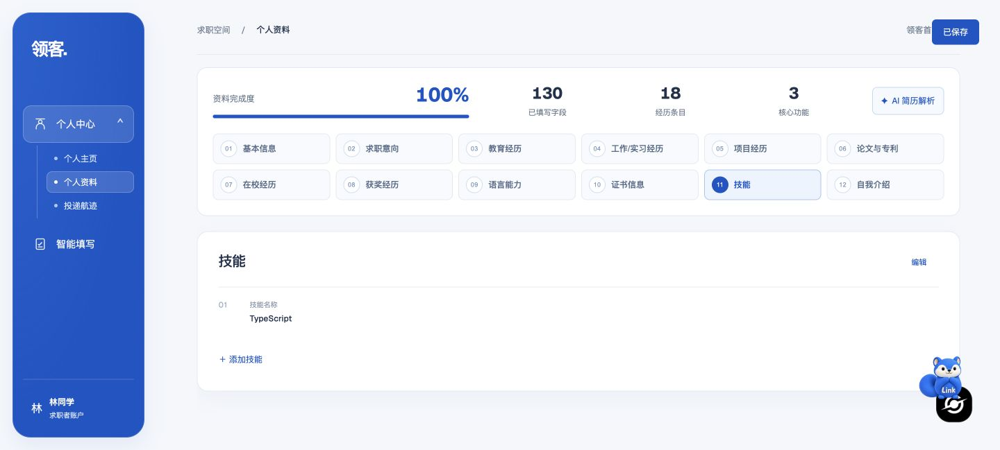

# 基本资料保存修复与复测

修复目标：产品验收报告 BUG-01（保存基本信息误删技能）和 BUG-05（无关经历 ID 重建）。

## 改动

- 前端按当前分区提交差异：基本信息、自我介绍、求职意向不发送经历；经历分区只发送该分区、已有 ID 和真正改动的字段。没有 kind 的标准技能也正常显示。
- API 将资料和经历写入放在同一事务中；只同步请求明确提供的分区，原记录原 ID 更新、新记录创建、移除记录软删除。共享表中的语言/证书/技能、项目/奖项/论文、工作/校园互不清空。
- 保留未提交的字段和结构化 extra、主页头像/签名及意向；外部账号/其他分区的 ID、重复 ID、错误请求被拒绝并回滚。
- 保存成功后使用服务端返回的经历 ID；保存失败保留编辑内容，不提前显示成功。防止进行中的重复保存。
- 无数据库迁移；不变更页面填写逻辑，也不自动恢复其他用户此前已删除的记录。

## 按既有计划复测

| 计划项 | 检查重点 | 本地结果 | 远端结果 |
| --- | --- | --- | --- |
| PRO-01 | 只改微信/基本信息，其他资料及所有经历 ID 保持 | 通过 | Chrome 实际保存、刷新后仍18条；所有原ID、其他基本字段和意向保留 |
| PRO-02 | 经历原 ID 修改、新增后再保存不重复、删除只影响当前分区 | 通过 | Chrome 改项目角色→原ID/日期保留；新增技能19条→再保存仍19条、新ID和版本不变→移除后18条 |
| PRO-03 | 无 kind 技能可见，九类经历不串组 | 通过 | TypeScript可见；API清空语言分区后技能/证书不变，再恢复两条语言 |
| PRO-04 | 导出条数与 ID 稳定，无改动保存版本不变 | 通过 | 最终完整恢复18条、全部原ID及基线SHA-256；无改动保存版本不变 |
| HOME-01/03 | 头像、签名和未知 extra 保留 | 通过 | Chrome修改主页签名并恢复；头像/嵌套extra/意向保留，简历版本不变 |
| AUTH-05 | 跨账号/跨分区 ID 拒绝，错误请求整体回滚 | 通过 | 远端HTTP返回409；同一请求中的微信变更未落库 |
| EXT-03 | readiness/规则计划仍可读取保存后的完整简历 | 原集成通过 | 远端readiness版本与导出一致，美团规则计划返回正确姓名 |

现有相关自动化 103 项通过（契约5、API66、扩展10、Web22），Web 类型检查通过；真实隔离 PostgreSQL 新增专门保存回归，验证了11条九类记录的差异保存、元数据、事务和账号隔离。

远端8项API场景通过；真实Chrome另覆盖基本信息、项目编辑、技能新增/二次保存/移除及主页保存。每次回读按ID和字段逐项对比，不仅检查UI数量；最终合成账号与基线内容、ID及填写版本一致。

## API约定

`PATCH /profiles/me` 中 profile、preferences、records 都是可省略的部分更新；省略的内容不写入。`records` 按中文分区名同步：省略分区不修改，显式空数组只软删该分区。已有条目带原id，仅提交实际改动字段；新增条目不传id；保存响应records含真实数据库id，客户端后续必须复用。错误id或分区不被当作新条目创建；任何校验/写入失败整体回滚。旧UI格式的临时id仍可识别，但建议新客户端省略新增id。

## 发布

功能提交 `00f5ac6` 已推送 `codex/autofill-remote-test` 并部署到 `https://linkaigo.com/autofill-test`，API/Web镜像标签均为 `profile-save-fix-20261018`。Web linux/amd64生产构建通过；API在测试机复用既有基础镜像构建，仅覆盖资料读/写服务、API入口及此前投递服务，填写引擎不变。

API镜像SHA-256：`6ad85e0fdd4c0a4e2f2a010721f792dd925f7e4002eb90f135e15e8848c7495f`。Web镜像索引SHA-256：`ca1fdf9443819320b597d12990e4f05e121e032a8bdf7dd83af2a33c2f264680`。

测试健康、扩展下载、主站健康均200；主站容器未重启。配置备份为测试目录 `.env.autofill-test.before-profile-save-fix`，保留旧镜像和数据卷。回滚时恢复该文件并compose重建测试api/web，无数据库迁移；远端剩余约681MB。

本轮仅复测改动相关计划项及发布健康检查。注册/AI接口404、Moka/模型配置、任务状态、学历日期回显、时区及填写速度/完整度等其他已知问题不属于本次修复，旧验收结论保留。

本机证据：忽略目录 `apps/extension/.test-dist/profile-save-fix-20261018/`；含工作区/Web测试日志、类型检查、PG集成、Docker构建、api-results、baseline、basic/project/added-skill/repeat-skill/removed-skill/final结果、homepage-results、UI结果和截图。仅提交合成数据的汇总结论与脱敏截图，不提交凭据和原始资料。
