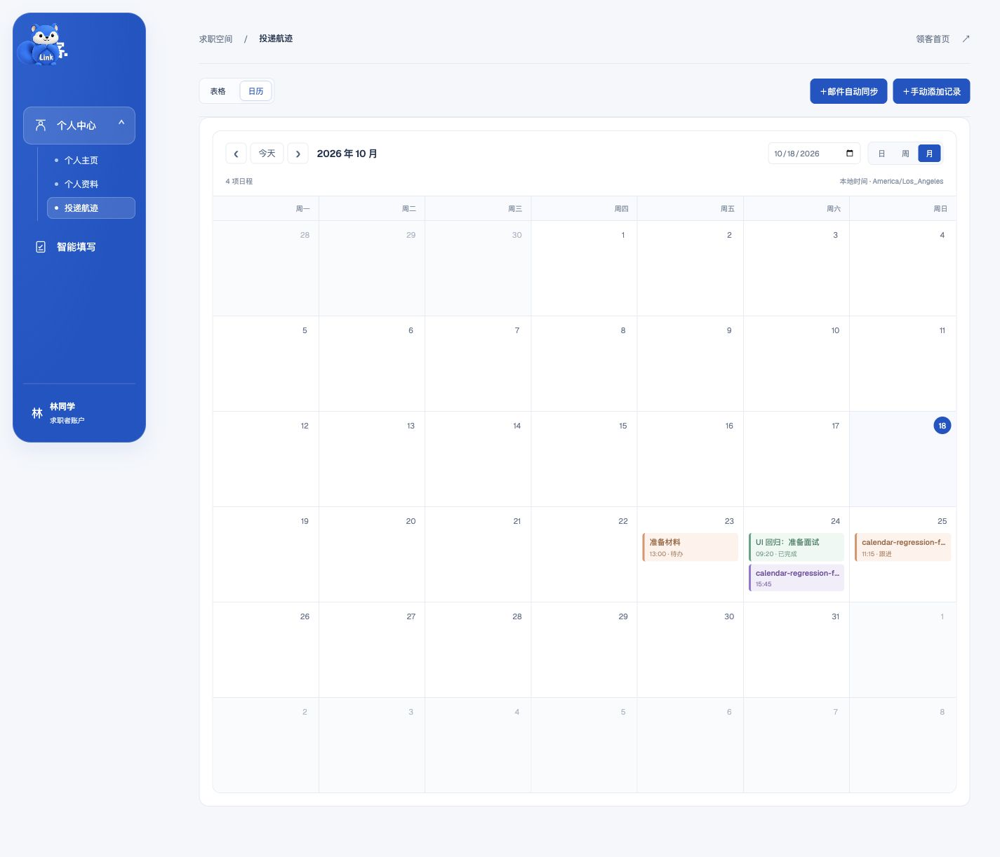

# 任务、面试与日历修复复测

2026-10-18；功能提交 `6694b9f`，对应原报告 BUG-06、BUG-07 和计划 APP-04/05/06。已推送 `codex/autofill-remote-test`，部署于[隔离测试站](https://linkaigo.com/autofill-test/workspace/applications)。

## 修复内容

- 任务创建、更新和查询只允许 `open`、`done`；空标题、无效日期返回 400，不写入错误数据。同一幂等键不能串到另一条投递记录，所有查询与修改继续按登录账号隔离。
- 编辑框和日历统一使用浏览器本地时区，并明确显示时区。查询范围按当地午夜计算，覆盖夏令时 23/25 小时的日期；投递日期保持日期本身，不因 UTC 转换倒退一天。
- 新增、完成、重开任务及保存安排后立即刷新当前日历。`done` 显示“已完成”；任务更新同步详情与父页面，保存主记录不会丢失已加载的任务、邮件和历史。
- `nextFollowUpAt` 在日历中独立显示为跟进提醒，标题包含 `nextAction`。提醒、面试和任务各自保留，不额外复制成数据库任务；清空提醒只移除这项提醒。
- 面试继续只要求开始时间。API 和邮件自动关联路径在改期时清除旧结束时间；手动编辑的安排继续受保护。显式结束时间必须晚于开始时间；跨查询起点的已有面试也进入日历。
- 日历快速切换范围时忽略过期请求；点击未在当前投递列表缓存中的记录会按 ID 读取详情。

## 复测表

| 检查 | 结果与证据 |
| --- | --- |
| API 模块测试 | 76/76，通过；新增 10 项任务/面试/日历回归 |
| Web 模块测试 | 42/42，通过；新增 12 项时区、日期、跨日、状态和重叠布局回归 |
| Web 类型检查 | `tsc --noEmit` 通过 |
| 标准 Docker 构建 | API、Web 的 linux/amd64 生产构建通过 |
| 本地 PostgreSQL 集成 | 完整 API 集成通过，含 12 组新增检查、两账号隔离、任务幂等、改期与资料保留 |
| 远端 HTTP 复测 | 同样 12 组检查通过；非法状态创建/PATCH、空标题、无效日期、反向日历范围返回 400 |
| 时间一致性 | Chrome 本机 America/Los_Angeles：编辑框与日历均为 10/21 14:30；改为 10/24 15:45 后立即移到新日期，无需手动刷新 |
| 任务新增/完成/重开 | Chrome 新增 10/24 09:20 的“UI 回归：准备面试”；完成后计数减少、勾选和日历“已完成”一致；重开后恢复“待办” |
| 跟进提醒 | Chrome 将提醒从 10/22 12:00 改到 10/25 11:15，同时修改下一步行动；旧提醒消失，新提醒出现，面试与两项任务保留 |
| 面试清空/恢复 | Chrome 清空时间后日历仅移除面试，保留跟进和两项任务；再次只填开始时间可保存，没有结束时间输入 |
| 日/周/月与刷新 | Chrome 三种视图切换通过；完整刷新后面试 15:45、提醒 11:15、任务 09:20 及完成状态仍保留；投递日期仍是 10/21 |
| 时区边界 | 模块测试覆盖洛杉矶、上海、UTC、加尔各答和洛杉矶夏令时切换；其他时区未做独立浏览器端到端，不宣称已实测 |
| 资料保留 | 测试账号原有 18 条经历、全部记录内容/ID 和 profileVersion 与基线一致；未修改真实用户资料 |
| 健康检查 | 主站与测试 API、测试登录/找回密码页均返回 200；主站 API/Web 启动时间不变 |

浏览器通过真实页面控件填写、点击保存和切换视图；独立 HTTP 回读确认持久化。任务 checkbox 的自动化 `check()` 曾因受控控件等待服务器响应而提前断言失败，随后确认实际勾选成功，后续使用真实 click 并核对终态；不把点击尝试当作通过。

## 部署与回滚

- Release：`tasks-calendar-20261018`。Web 镜像 manifest SHA-256：`f6b288a9308137b2de042a1fbc5d394c7e8f2dd6d1f52b6cc6ab1b1096ce3450`。
- API 远端磁盘有限，沿用已部署 `auth-recovery-20261018` 依赖镜像，仅覆盖 `apps/api/src/modules/applications/service.js`，镜像 SHA-256：`e5745e3f3dae7999a6a96e2bad5dd6ff8e108cdbaa029d1e667261e9f994d33d`。容器内模块与提交文件 SHA-256 一致：`f227d9e7b60b045f37d48dd5ed15944b4105a14fd66c54ac8562715f0755749a`。标准 API 全量构建另在本机通过，没有把 1.8 GB 全量镜像传入测试服务器。
- 仅重建隔离测试 API/Web。无数据库迁移、无代理或供应商配置改动，填写引擎与扩展未修改；主站 API/Web 未重启。部署后剩余约 538 MB，保留上一版镜像。
- 配置备份 `/opt/lingke-autofill-test/.env.autofill-test.before-tasks-calendar`；回滚时恢复该文件，按现有 Compose 命令仅重建测试 API/Web。
- 原始日志、HTTP 结果、UI 核对和基线在忽略目录 `apps/extension/.test-dist/tasks-calendar-fix-20261018/`；构建/API 测试和本地数据库集成日志在其上层同名前缀文件。凭据、Cookie、原始资料不提交。

本轮只关闭已覆盖的任务与日历缺陷，不重测招聘页填写性能，也不代表原测试报告中其他问题已修复。
